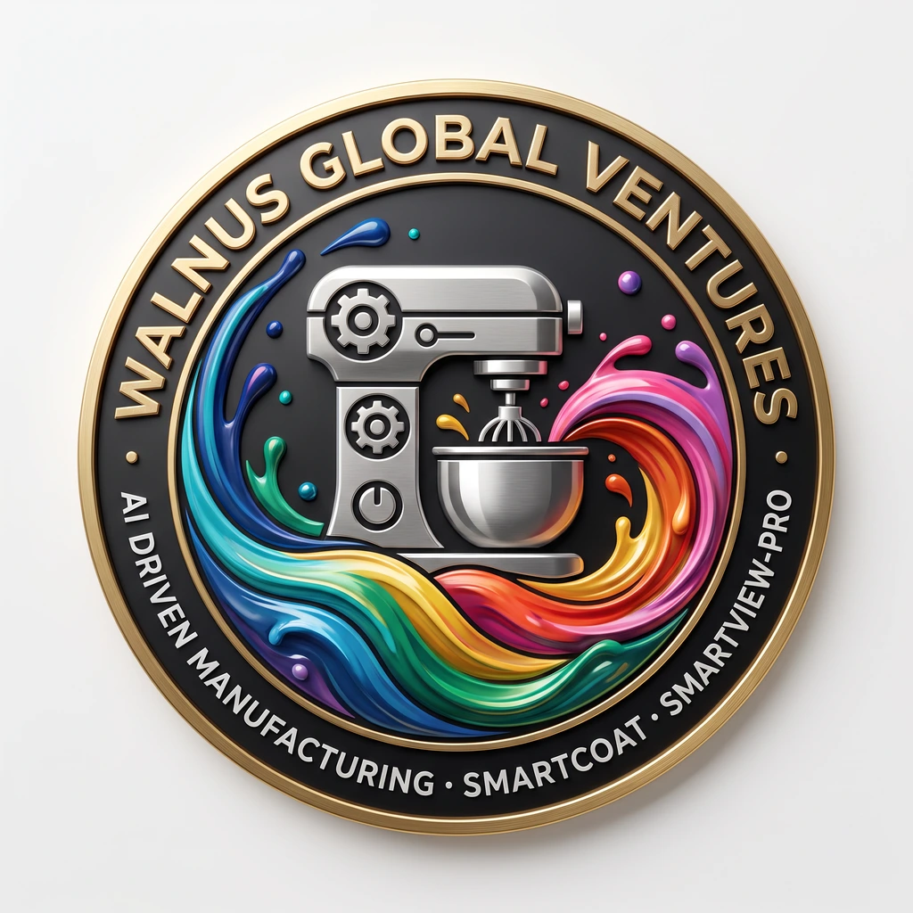
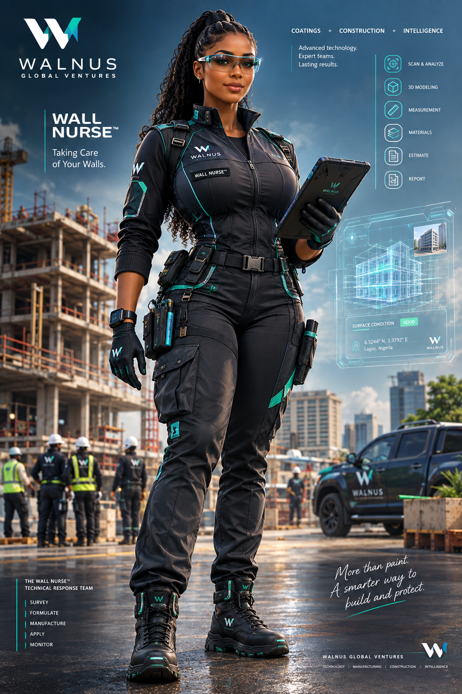

# 🌐 Walnus Global Ventures — SmartCoat Order App & Digital Platform 🚀

[](#-tech-stack)
[](#-project-overview)
[](#)

<div align="center">
  
  <br/>
  <h3><strong>Coatings. Construction. Intelligence.</strong></h3>
  <p><em>A technology-enabled coatings, manufacturing, and construction project intelligence platform for the modern built environment.</em></p>
</div>

---

## 📖 Table of Contents
- [✨ Project Overview](#-project-overview)
- [🎯 Key Capabilities & Ecosystem](#-key-capabilities--ecosystem)
- [🛠 Technical Specifications](#-technical-specifications)
- [📸 Preview & Visual Design](#-preview--visual-design)
- [📦 Installation & Getting Started](#-installation--getting-started)
- [🏗 Architecture & Project Structure](#-architecture--project-structure)
- [👨‍💻 Developer Contacts](#-developer-contacts)

---

## ✨ Project Overview

**Walnus Global Ventures** is not just an ordinary paint company — it is a **technology-enabled coatings and construction intelligence enterprise**. 

The **SmartCoat Order App & Digital Platform** serves as the public front door and digital operations layer connecting paint manufacturing, coating intelligence, project management, and on-site professional execution.

### Key Value Pillars:
- 🧪 **Precision Formulation**: High-performance architectural and industrial coatings engineered for durability, weather resistance, and aesthetics.
- 📱 **SmartCoat™ Intelligence**: Digital ordering, batch calculation, automated surface area analysis, and custom color matching.
- 📊 **SmartView Pro™**: Real-time project tracking, digital milestones, inspection sign-offs, and quality assurance workflows.
- 🤝 **Certified Contractor Network**: Seamless matching between property developers, project managers, and trained coating specialists.

---

## 🎯 Key Capabilities & Ecosystem

| Pillar | Focus | Features |
| :--- | :--- | :--- |
| **🎨 Paint Manufacturing** | Premium Coatings | High-yield emulsion, weather-shield coatings, satin finishes, industrial primers |
| **🤖 SmartCoat™ App** | Smart Ordering & AI Tools | Formulation calculator, instant volume estimates, real-time order tracking |
| **📐 SmartView Pro™** | Project Intelligence | Quality audits, milestone progress logging, site execution records |
| **👷 Professional Services** | Turnkey Execution | Certified application crews, commercial painting, architectural finishing |

---

## 🛠 Technical Specifications

- **Frontend & Runtime:** Modern HTML5 / Next.js 16 (App Router) & React 19 / TypeScript 5
- **Styling & UI:** Tailwind CSS (v4) with custom typography, glassmorphism, responsive navigation, and accessible UI tokens
- **Asset Pipeline:** High-performance responsive image rendering with modern WebP and optimized formats
- **Icons & Typography:** SVG iconography + Google Inter typography (`Inter: 400, 500, 600, 700, 800`)

---

## 📸 Preview & Visual Design

<div align="center">
  
  <p><em>Hero Section: High-durability coatings applied with technical precision (Hero opacity: 50%)</em></p>
</div>

<br/>

<div align="center">
  
  <p><em>SmartView Pro™ & SmartCoat™ Interactive Management Interface</em></p>
</div>

---

## 📦 Installation & Getting Started

### Prerequisites
- [Node.js](https://nodejs.org/) (version 18.x or later recommended)
- `npm`, `pnpm`, or `yarn`

### 1. Clone the Repository
```bash
git clone https://github.com/walnusglobal-code/SmartCoat-Order-App-v1.git
cd SmartCoat-Order-App-v1
```

### 2. Install Dependencies
```bash
npm install
# or
yarn install
# or
pnpm install
```

### 3. Run the Development Server
```bash
npm run dev
# or
yarn dev
```

Open [http://localhost:3000](http://localhost:3000) in your browser to view the application.

### 4. Viewing the Standalone Landing Page
You can also view the standalone landing page immediately:
```bash
npx serve .
# or open index.html directly in any modern browser
```

### 5. Production Build
```bash
npm run build
npm run start
```

---

## 🏗 Architecture & Project Structure

```plaintext
walnus-global-ventures-website/
├── attachments/                       # Media, brand assets, and design specifications
│   ├── d7ff20a7-f353-4b54-8033-29fd8b30d74d/
│   │   ├── logo.webp                 # Official Walnus Global brand mark
│   │   ├── 638b254dc6645c374fe97559b8cb761e.jpg # Hero background asset
│   │   └── Walnus_Global_Homepage_Design_Spec.md
├── public/                            # Static public web assets
├── src/                               # Next.js App Router source
│   └── app/
│       ├── layout.tsx                 # Root layout & font definition
│       ├── page.tsx                   # Page component
│       └── globals.css                # Global CSS & Tailwind imports
├── index.html                         # Polished standalone interactive landing page
├── package.json                       # Scripts and project dependencies
├── tsconfig.json                      # TypeScript configuration
└── README.md                          # Project documentation
```

---

## 👨‍💻 Developer Contacts

For technical queries, collaboration, and partnership inquiries:

- ✉️ **Email:** [seanlawal@gmail.com](mailto:seanlawal@gmail.com)
- 💼 **LinkedIn:** [Oluwaseun Lawal](https://www.linkedin.com/oluwaseun-lawal)
- 🐙 **GitHub Profile 1:** [@shawn-price](https://github.com/shawn-price/)
- 🐙 **GitHub Profile 2:** [@cyberlawaltech](https://github.com/cyberlawaltech)

---

<div align="center">
  <sub>© Walnus Global Ventures. All rights reserved. Built with intelligence for the African built environment.</sub>
</div>
